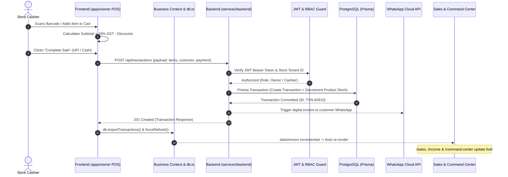

# 🏛️ Bizora AI — Full-Stack Architecture & Codebase Guide
> **Enterprise Autonomous Retail Operating System, Multi-Store ERP & Decision Intelligence**

---

## 📑 Table of Contents
1. [Monorepo Architecture Overview](#1-monorepo-architecture-overview)
2. [Frontend Architecture (`apps/`)](#2-frontend-architecture-apps)
3. [Backend Architecture (`services/backend`)](#3-backend-architecture-servicesbackend)
4. [Shared Packages (`packages/`)](#4-shared-packages-packages)
5. [Dual-Database Architecture (PostgreSQL + MongoDB)](#5-dual-database-architecture)
6. [End-to-End Request & Data Flow](#6-end-to-end-request--data-flow)
7. [AI & Autonomous Decision Intelligence Engine](#7-ai--autonomous-decision-intelligence-engine)
8. [Production Deployment & Infrastructure](#8-production-deployment--infrastructure)
9. [Interview Q&A: Master Explanations for Technical Evaluators](#9-interview-qa-master-explanations)

---

## 1. Monorepo Architecture Overview

Bizora is organized as an enterprise **Turbo Monorepo** (similar to architectures used at Google, Uber, and Vercel). The codebase enforces a clean separation of concerns:

```
omni-mind-vue-main/
├── apps/                          # 🖥️ FRONTEND APPLICATIONS
│   ├── owner/                     # Store Owner & Manager ERP / POS Portal
│   ├── admin/                     # Platform Super-Admin Governance Portal
│   ├── supplier/                  # B2B Vendor Procurement & Dispatch Hub
│   ├── customer/                  # Hyperlocal Neighborhood Storefront
│   └── web/                       # Public Landing, Pricing & Marketing Portal
│
├── services/                      # ⚙️ BACKEND SERVICES & MICROSERVICES
│   └── backend/                   # Centralized NestJS / Express REST API Microservice
│
├── packages/                      # 📦 SHARED INTERNAL PACKAGES
│   ├── database/                  # Prisma ORM Schema, Migrations & Supabase Client
│   ├── types/                     # Shared TypeScript interfaces & DTO contracts
│   └── ui/                        # Shared Design System primitives & Tailwind tokens
│
└── package.json                   # Monorepo root workspace configuration
```

### Why a Monorepo?
- **Contract Type Safety**: TypeScript interfaces in `packages/types` are shared synchronously between frontend and backend. Any API contract change fails compilation if frontend and backend get out of sync.
- **Independent Deployability**: Even though all code lives in one repository, each frontend portal and the backend service deploy independently on Render with their own isolated build pipelines and environment secrets.

---

## 2. Frontend Architecture (`apps/owner`)

The Store Owner portal is the core application handling daily retail operations, POS billing, and executive analytics.

### Tech Stack
- **Framework**: React 19 + TypeScript
- **Bundler & Tooling**: Vite 6 / Rolldown
- **Routing**: TanStack Router (type-safe, file-based routing with code splitting)
- **Styling**: Tailwind CSS + Radix UI primitives (shadcn-compatible)
- **Charts & Visualization**: Recharts (reactive SVG charts with hardware-accelerated animations)
- **Icons**: Lucide React
- **Notifications**: Sonner toast system

### Directory Structure of `apps/owner`:
```
apps/owner/src/
├── routes/                        # File-based routes (TanStack Router)
│   ├── _app.tsx                   # Main layout (sidebar, topbar, drawers)
│   ├── _app.command-center.tsx    # Live Executive KPIs & store telemetry
│   ├── _app.billing.tsx           # POS Barcode scanner & checkout engine
│   ├── _app.sales.tsx             # Revenue analytics, AOV & order trends
│   ├── _app.products.tsx          # Inventory catalogue, batch control & OCR
│   ├── _app.inventory.tsx         # Stock tracking, reorder thresholds & low-stock alerts
│   ├── _app.customers.tsx         # CRM loyalty tiers, khata ledger & spend history
│   ├── _app.income.tsx            # Inflow tracking, POS vs sub-lease vs ancillary income
│   ├── _app.expenses.tsx          # Operating expenses, category breakdowns & forecast
│   ├── _app.suppliers.tsx         # Vendor scorecard & purchase order tracking
│   ├── _app.reports.tsx           # P&L, GST taxation & Excel/PDF export reports
│   └── _app.settings.tsx          # Store settings, GSTIN & WhatsApp credentials
│
├── components/                    # Reusable UI components
│   ├── kpi-card.tsx               # Metric cards with sparklines & deltas
│   ├── page-header.tsx            # Standardized page headers with actions
│   └── ui/                        # Radix UI wrappers (dialog, select, tabs, button)
│
└── lib/                           # State management, API clients & local caching
    ├── business-context.tsx       # Core React Context (central business state & reactive sync)
    ├── auth-context.tsx           # Authentication state (JWT session, RBAC user)
    ├── db.ts                      # LocalStorage offline-first cache & mock seeds
    ├── api-client.ts              # Fetch wrapper with JWT headers & error handling
    ├── api-transactions.ts        # Transaction API calls
    ├── api-products.ts            # Product API calls
    ├── api-customers.ts           # Customer CRM API calls
    └── api-expenses.ts            # Ledger expense API calls
```

### Key Frontend Concepts to Explain:
1. **Dual-Layer Synchronization**: Frontend queries backend REST endpoints. If network latency occurs, the local `db.ts` cache acts as a self-healing buffer so POS billing never halts.
2. **Reactive `dataVersion`**: When a cashier bills an order in `/billing`, `forceRefresh()` increments `dataVersion`. Every active view (`/sales`, `/income`, `/command-center`, `/expenses`) reacts immediately and updates charts without requiring a browser reload.

---

## 3. Backend Architecture (`services/backend`)

The backend is an enterprise-grade REST microservice built with **NestJS** and **Express**.

### Tech Stack
- **Framework**: NestJS v10 / Express v4
- **Language**: TypeScript (strict mode)
- **Runtime**: Node.js 20 LTS
- **ORMs**: Prisma (PostgreSQL) + Mongoose (MongoDB Atlas)
- **Security**: JWT (`jsonwebtoken`), `bcryptjs`, `helmet`, `cors`, RBAC guards
- **Communication APIs**: WhatsApp Cloud API / Twilio, Resend (email), Vapi AI (voice dispatch)

### Directory Structure of `services/backend`:
```
services/backend/src/
├── main.ts                        # Application bootstrap, CORS, helmet & global filters
├── app.module.ts                  # Root NestJS dependency injection module
│
├── controllers/                   # HTTP Request Handlers (Routing & Input Validation)
│   ├── auth.controller.ts         # User login, registration, JWT refresh & logout
│   ├── transactions.controller.ts # POS checkout, payment capture & receipt emission
│   ├── sales.controller.ts        # Historical sales aggregation & AOV telemetry
│   ├── product.controller.ts      # Product CRUD, barcode lookup & stock adjustment
│   ├── inventory.controller.ts    # Batch tracking, reorder alert dispatch
│   ├── customers.controller.ts    # Customer CRM, loyalty points & khata debt
│   ├── expenses.controller.ts     # Operational expense logging & categorization
│   ├── ledger.controller.ts       # Double-entry balance sheet & P&L calculation
│   ├── ai.controller.ts           # AI copilot chat, restock recommendations & OCR
│   ├── analytics.controller.ts    # Anomaly detection & predictive forecasting
│   ├── suppliers.controller.ts    # Vendor procurement & purchase orders
│   ├── health.controller.ts       # DevOps watchdog & self-healing health probe
│   └── comms.controller.ts       # WhatsApp receipt dispatch & Vapi voice alerts
│
├── services/                      # Business Logic Layer (Clean Architecture)
│   ├── transactions.service.ts    # Stock deduction, tax calculation & transaction creation
│   ├── sales.service.ts           # Time-series analytics & revenue rollup logic
│   ├── product.service.ts         # SKU uniqueness, catalog indexing & pricing
│   ├── expenses.service.ts        # Category breakdown & monthly forecast math
│   ├── ai.service.ts              # LLM orchestration, prompt injection & anomaly scoring
│   ├── comms.service.ts           # WhatsApp & SMS notification delivery
│   └── health.service.ts          # Ping checks for MongoDB, PostgreSQL & memory usage
│
├── models/                        # MongoDB Mongoose Models (Unstructured Data)
│   ├── transaction.model.ts       # Raw transaction document schema
│   ├── product.model.ts           # Product catalog with dynamic attributes
│   ├── customer.model.ts          # Customer profile & activity timestamps
│   ├── expense.model.ts           # Operating expense document schema
│   └── audit-log.model.ts         # Immutable security audit trail
│
├── guards/ & middlewares/         # Security & Access Control
│   ├── jwt-auth.guard.ts          # Bearer token verification
│   ├── rbac.middleware.ts         # Role enforcement (Owner vs Admin vs Cashier)
│   └── security.middleware.ts     # Rate limiting & injection sanitization
│
└── ai/                            # Decision Intelligence Subsystem
    ├── agents/                    # Autonomous agents (Stockout, Anomaly, Markdown)
    └── prompts/                   # Few-shot prompts for retail reasoning
```

---

## 4. Shared Packages (`packages/`)

To prevent code duplication and guarantee type safety across the entire platform:

1. **`packages/database`**:
   - `prisma/schema.prisma`: The canonical schema definition for PostgreSQL (Supabase). Contains relations for `User`, `Company`, `Product`, `Transaction`, `TransactionItem`, `Customer`, `Supplier`, `Expense`.
   - Exports the singleton `prisma` client used across backend services.
2. **`packages/types`**:
   - Houses shared DTOs: `TransactionDTO`, `ProductDTO`, `CustomerDTO`, `KpiResponse`.
   - Both `apps/owner` and `services/backend` import from `@bizora/types`.
3. **`packages/ui`**:
   - Shared atomic UI components used across the Store Owner, Admin, and Supplier frontends.

---

## 5. Dual-Database Architecture

Bizora leverages a **Polyglot Persistence (Dual-Database)** strategy to optimize for both ACID financial reliability and high-speed flexible retail catalogues:

```
                  ┌───────────────────────────────────────────────┐
                  │           BIZORA BACKEND ENGINE               │
                  └──────────────┬─────────────────┬──────────────┘
                                 │                 │
                Prisma ORM (ACID)│                 │Mongoose (Document)
                                 ▼                 ▼
                  ┌────────────────────────┐  ┌────────────────────────┐
                  │       PostgreSQL       │  │     MongoDB Atlas      │
                  │       (Supabase)       │  │     (Document Store)   │
                  ├────────────────────────┤  ├────────────────────────┤
                  │ • Financial Ledgers    │  │ • Unstructured Products│
                  │ • Billing Transactions │  │ • Barcode Catalogues   │
                  │ • Double-entry Accounts│  │ • AI Prompts & Vector   │
                  │ • User RBAC & Auth     │  │   Telemetry Embeddings │
                  │ • Audit Compliance     │  │ • Telemetry Event Logs │
                  └────────────────────────┘  └────────────────────────┘
```

### Why use two databases?
- **PostgreSQL**: Used for transactions, billing, tax calculation, and financial accounting where ACID transactions (`BEGIN ... COMMIT`) prevent negative stock or corrupted ledgers.
- **MongoDB**: Used for high-throughput product lookups, barcode index caches, customer behavioural logs, and AI conversation history where schemas vary across different retail verticals (e.g. Pharmacy batch numbers vs Fashion clothing sizes).

---

## 6. End-to-End Request & Data Flow

Here is the exact lifecycle of a POS Sale from barcode scan to executive analytics:



---

## 7. AI & Autonomous Decision Intelligence Engine

Bizora features integrated decision intelligence engineered specifically for retail operators:

1. **Autonomous Anomaly Detection**:
   - Detects abnormal electricity consumption spikes (e.g. HVAC compressor failures), unusual return rates, or margin erosion.
   - Algorithms flag deviations greater than $2.5\sigma$ from rolling 30-day baseline.
2. **Predictive Restock & Markdown Optimizer**:
   - Analyzes product sales velocity against remaining shelf-life.
   - Dynamically recommends markdowns (e.g. 20% off expiring dairy batches) to liquidate stock before expiry.
3. **Automated Supplier Reordering**:
   - When inventory hits `reorderLevel`, the AI drafts a digital Purchase Order (PO) and can automatically dispatch restock requests via WhatsApp or automated Vapi voice calls to registered suppliers.

---

## 8. Production Deployment & Infrastructure

All components are deployed in production on Render:

| Service | Technology | Hosting | Production URL |
|---|---|---|---|
| **Store Owner** | React 19 / TanStack Router | Render Static / Nitro | `https://bizora-owner.onrender.com` |
| **Super Admin** | React 19 / TanStack Router | Render Static / Nitro | `https://bizora-admin.onrender.com` |
| **Supplier Hub** | React 19 / TanStack Router | Render Static / Nitro | `https://bizora-supplier.onrender.com` |
| **Customer Store**| React 19 / TanStack Router | Render Static / Nitro | `https://bizora-customer.onrender.com` |
| **Marketing** | React 19 / TanStack Router | Render Static / Nitro | `https://bizora-web.onrender.com` |
| **Backend REST** | NestJS / Express / Node 20 | Render Web Service | `https://bizora-backend-gtoe.onrender.com` |
| **PostgreSQL** | Supabase Managed Postgres | Supabase Cloud | Managed via Prisma connection pool |
| **MongoDB** | MongoDB Atlas M10 Replica Set | AWS Mumbai Region | Managed via Mongoose connection pool |

---

## 9. Interview Q&A: Master Explanations for Technical Evaluators

### Q1: "Can you explain the high-level architecture of your project?"
> *"Bizora is architected as an enterprise monorepo with strict decoupling between client applications and backend microservices. On the frontend, we maintain five role-specific applications—Store Owner, Admin, Supplier, Customer, and Marketing—built with React 19, TypeScript, and TanStack Router for type-safe routing. On the backend, we run a centralized NestJS microservice that orchestrates REST APIs, autonomous AI decision agents, and communication gateways. We use a polyglot persistence strategy with PostgreSQL on Supabase for strict ACID financial ledgers and MongoDB Atlas for flexible product catalogs and unstructured telemetry."*

### Q2: "Why did you choose a Monorepo instead of completely separate Git repositories?"
> *"A monorepo using modern workspaces allows us to maintain shared contracts in `packages/types` and unified database models in `packages/database`. If an API payload for transactions or products changes, our TypeScript compiler catches contract mismatches across all frontends instantly during CI build verification, preventing runtime 400 or 500 errors. At the same time, each frontend and the backend deploy to Render independently."*

### Q3: "How does frontend state stay in sync when a cashier creates a bill?"
> *"We implement a reactive event-driven context architecture via `BusinessDataContext`. When a transaction completes, the checkout engine performs an atomic write to the server while updating our local client store, incrementing an internal state version (`dataVersion`). Dependent routes—like Sales Intelligence, Income Inflows, and the Executive Command Center—listen to this version key and re-render their KPIs and Recharts visualizations instantly without requiring a page reload."*

### Q4: "Why use both PostgreSQL and MongoDB? Isn't one database enough?"
> *"In retail systems, data access patterns are fundamentally heterogeneous. Financial transactions, tax GST accounting, double-entry ledgers, and invoice numbering require strict ACID guarantees, foreign keys, and serializable isolation to prevent double-spending or negative stock. PostgreSQL is optimal for this. Conversely, retail product catalogs vary drastically across verticals—a pharmacy requires drug batch numbers and expiry dates, while a fashion store requires sizes and color matrices. MongoDB's document model provides schema flexibility and sub-millisecond barcode lookups without requiring heavy schema migrations for every new vertical."*

### Q5: "How does your AI decision intelligence work?"
> *"Our AI subsystem operates on two tiers: algorithmic statistical anomaly detection and LLM-driven decision reasoning. For time-series metrics like footfall and utility consumption, we calculate rolling standard deviations to flag statistical anomalies. For business recommendations, our AI agent analyzes inventory turnover against batch expiry dates and dynamically generates actionable insights—such as recommending a 20% markdown on slow-moving inventory to clear capital before expiry. It also integrates with external voice and message gateways (Vapi and WhatsApp) to execute purchase order dispatches autonomously."*
