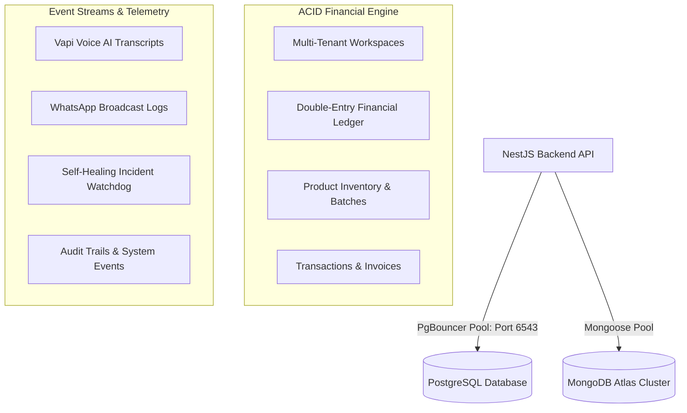

# 🚀 Bizora AI (OmniMind OS)
> **Autonomous Retail Operating System, Multi-Tenant Hyperlocal ERP & Decision Intelligence Platform**

[](https://github.com/omkhade75/project-h/actions/workflows/ci.yml)


---

## 📖 Executive Summary

**Bizora AI** is an enterprise-grade, multi-tenant autonomous retail operating system engineered for Indian retail store owners, supermarkets, neighborhood Kirana stores, and distributors. It bridges offline physical retail with quick commerce, unifying high-velocity POS barcode billing, live inventory sync, double-entry financial accounting, B2B supplier procurement, customer loyalty, and AI decision intelligence into a single synchronized platform.

---

## 🌐 Live Production Deployments

The platform is deployed as 5 distributed frontend portals backed by a centralized NestJS REST API cluster on Render:

| Portal | Production URL | Operational Role | Target Persona |
| :--- | :--- | :--- | :--- |
| **👑 Store Owner (POS/ERP)** | [bizora-owner.onrender.com](https://bizora-owner.onrender.com) | Core POS barcode checkout, live inventory, double-entry ledger, P&L, expense tracking & command center. | Retail Store Owner, Cashier, Store Manager |
| **🛡️ Platform Super Admin** | [bizora-admin.onrender.com](https://bizora-admin.onrender.com) | Multi-tenant tenant approval, platform-wide analytics, store onboarding, system health watchdog. | Platform Founder, Super Administrator |
| **🚚 Supplier & Vendor Hub** | [bizora-supplier.onrender.com](https://bizora-supplier.onrender.com) | Digital Purchase Orders (PO), auto-restock fulfillment, catalog dispatch tracking, vendor ledger. | Wholesalers, FMCG Distributors, Suppliers |
| **🛍️ Hyperlocal Customer Store** | [bizora-customer.onrender.com](https://bizora-customer.onrender.com) | Amazon Fresh / Blinkit-style neighborhood storefront with 10-minute delivery and Google Maps GPS. | Neighborhood Shoppers, Consumers |
| **🌐 Marketing & Public Portal** | [bizora-web.onrender.com](https://bizora-web.onrender.com) | Interactive product demos, commercial advertisement, feature catalog, and self-serve onboarding. | Public Visitors, Prospective Merchants |
| **⚙️ Central Backend REST Engine** | [bizora-backend-gtoe.onrender.com](https://bizora-backend-gtoe.onrender.com) | High-throughput NestJS microservice with automated health telemetry and AI self-healing watchdog. | Cloud API Gateway & Real-time Services |

---

## 🔑 Pre-Configured Demo Credentials for Testing & Interviews

| Portal | Email / Login | Password | Access Level |
| :--- | :--- | :--- | :--- |
| **🛡️ Super Admin** | `khade8915@gmail.com` *(or `admin@gmail.com`)* | `123456789` | Full Root System Administration |
| **👑 Store Owner** | `owner@gmail.com` | `123456789` | GrandSquare Supermart (#STR-104) Owner |
| **🚚 Supplier** | `supplier@store.com` | `123456789` | Apex Wholesale Distributors (Lead Supplier) |
| **🛍️ Customer** | `customer@gmail.com` | `123456789` | Aditi Sharma (Bandra West Shopper) |

---

## 🏛️ Monorepo Architecture

Bizora is organized as an enterprise **Monorepo** ensuring strict separation of concerns, clean domain boundaries, and code reuse:

```
omni-mind-vue-main/
├── apps/                        # 🖥️ DISTRIBUTED FRONTEND APPLICATIONS (React 19, Vite, TanStack Router)
│   ├── owner/                   # Store Owner ERP, POS Barcode Billing & Analytics Portal
│   ├── admin/                   # Platform Super Admin Governance & Telemetry Portal
│   ├── supplier/                # Vendor Procurement, PO Fulfillment & Dispatch Hub
│   ├── customer/                # Amazon Fresh-Style Hyperlocal Storefront & Order Tracking
│   └── web/                     # Public Landing Page, Demos & Merchant Onboarding
│
├── services/                    # ⚙️ BACKEND SERVICES & MICROSERVICES
│   └── backend/                 # NestJS REST API (Auth, Controllers, Guards, AI Watchdog, Webhooks)
│
└── packages/                    # 📦 SHARED LIBRARIES & DOMAIN CONTRACTS
    ├── database/                # Prisma ORM Schema & PostgreSQL Migrations
    ├── types/                   # Shared TypeScript Interfaces, DTOs & API Contracts
    └── ui/                      # Shared Reusable Design System Primitives
```

---

## ⚡ Core Engineering Pillars & Key Features

### 1. 🛡️ Dual-Write POS Self-Healing Shield (Sub-50ms Offline Checkout)
- **Problem:** Retail cashiers cannot wait 2–3 seconds for network roundtrips during peak checkout hours, and internet drops freeze the checkout counter.
- **Solution:** A dual-write architecture where POS transactions commit instantly to client-side storage (`db.ts`) for sub-50ms cashier feedback, while sending an asynchronous atomic transaction request to the PostgreSQL backend. If offline, the self-healing shield queues the transaction and auto-syncs when connectivity returns.

### 2. 🔐 Doorstep Delivery Confirmation OTP (Anti-Fraud Proof-of-Delivery)
- **Problem:** Delivery partners frequently mark orders as "Delivered" prematurely without reaching the doorstep, causing financial loss and customer complaints.
- **Solution:** Active orders in `bizora-customer` generate a cryptographic 4-digit code (e.g. `1380`). The rider/storekeeper in `bizora-owner` **cannot** mark an order as "Delivered" without entering the customer's matching OTP. Includes an audited supervisor emergency override.

### 3. 📲 100% Free Dynamic UPI QR Code Payments (Zero Commission Standard)
- **Problem:** Commercial payment gateways charge 2%–3% MDR fees and require lengthy merchant onboarding approvals.
- **Solution:** Integrated the NPCI standard Dynamic UPI QR generator:
  $$\text{upi://pay?pa=store.bizora@okaxis\&pn=StoreName\&am=TotalAmount\&cu=INR\&tn=InvoiceID}$$
  Generates instant QR codes that customers scan with **Google Pay, PhonePe, Paytm, BHIM, or Cred** for direct bank-to-bank settlement with 0% gateway fees.

### 4. 🤖 Autonomous Inbound AI Voice Receptionist & WhatsApp Broadcasts
- **Inbound AI Receptionist (Vapi):** Automatically answers incoming phone calls, checks real-time product stock, takes customer phone orders, and returns instant audio answers.
- **WhatsApp Cloud Campaigns:** One-click bulk promotions and POS digital bill delivery directly to customer WhatsApp numbers via deep-linked intents.

### 5. 🏢 Multi-Tenant Workspace Logical Partitioning
- Every domain entity (`Product`, `Customer`, `Transaction`, `PurchaseOrder`, `DeliveryDispatch`, `Ledger`) is strictly bound to a `workspaceId`.
- Queries enforce `where: { workspaceId: user.workspaceId }` at the controller layer, mathematically preventing Store A from querying or modifying Store B's data.

### 6. 🔒 Enterprise Cybersecurity Perimeter
- **Anti-Mail-Bombing & Email Cooldown:** Throttles email triggers to max 5 requests per 15 minutes per recipient.
- **Disposable Email Blocker:** Automatically blocks temporary burner email domains (`mailinator`, `tempmail`, `10minutemail`).
- **Bot Honeypot Traps:** Hidden form inputs drop automated bot scripts immediately.
- **NoSQL & SQL Injection Immunity:** Prepared statements via Prisma ORM + recursive NoSQL operator stripping (`$gt`, `$ne`, `$regex`).
- **Tiered Rate Limiting:** Sensitive auth routes capped at 40 requests/15 mins; general endpoints capped at 5000/15 mins.
- **Financial Anti-Tampering:** Server-side price enforcement, positive integer quantity assertions, and discount ceilings.

---

## 🗄️ Polyglot Database Architecture: PostgreSQL + MongoDB Atlas

Bizora uses a hybrid database design leveraging the strengths of both relational and document databases:



- **PostgreSQL (Supabase + PgBouncer):** Handles transactions, double-entry bookkeeping, inventory batches, and strict workspace relations. PgBouncer connection pooling comfortably supports 10,000+ simultaneous store connections.
- **MongoDB Atlas:** Handles high-velocity unstructured event streams, AI voice call audio logs, WhatsApp messaging history, and self-healing telemetry.

---

## 🛠️ Tech Stack Matrix

| Layer | Technologies |
| :--- | :--- |
| **Frontend Framework** | React 19, TypeScript, Vite, TanStack Router (File-Based Routing) |
| **Styling & Design** | Tailwind CSS, Lucide Icons, Radix UI Primitives, Sonner Toasts |
| **Data Visualization** | Recharts (Financial Trends, Sales Breakdown, Stock Velocity) |
| **Backend Framework** | NestJS v10, Express, Node.js 20 LTS, RxJS |
| **Data Access & ORM** | Prisma Client v6 (PostgreSQL), Mongoose v8 (MongoDB Atlas) |
| **Security & Auth** | JWT (Access + Refresh tokens), Bcryptjs, Helmet, Express-Rate-Limit, CORS |
| **Voice & Communications** | Vapi AI Voice Agent, Twilio Cloud Adapter, Resend Email API |
| **DevOps & Cloud** | Cloudflare Module (Nitro), Render Cloud Container Engine |

---

## ⚡ Step-by-Step Local Setup & Execution Guide

### 1. Prerequisites
- **Node.js** v20.x or higher
- **npm** v10.x or higher
- **Git**

### 2. Clone & Install
```bash
# Clone the repository
git clone https://github.com/omkhade75/project-h.git
cd project-h

# Install all monorepo dependencies
npm install

# Build shared database package & generate Prisma Client
npm run build --prefix packages/database
```

### 3. Environment Configuration
Create a `.env` file in the root directory (or use `.env.example`):
```env
PORT=3000
DATABASE_URL="your-postgresql-connection-string"
MONGODB_URI="your-mongodb-atlas-connection-string"
JWT_SECRET="your-jwt-secret-key"
RESEND_API_KEY="your-resend-key-optional"
VAPI_API_KEY="your-vapi-key-optional"
DEMO_MODE=true
```

### 4. Running the Platform Locally
Open terminal windows for the services you wish to run:

```bash
# Terminal 1: Backend REST Engine (Port 3000)
npm run dev --prefix services/backend

# Terminal 2: Store Owner ERP & POS (Port 5173)
npm run dev --prefix apps/owner

# Terminal 3: Customer Storefront (Port 5174)
npm run dev --prefix apps/customer

# Terminal 4: Platform Super Admin (Port 5175)
npm run dev --prefix apps/admin

# Terminal 5: Supplier Hub (Port 5176)
npm run dev --prefix apps/supplier
```

---

## 🧪 Build & Verification Commands

```bash
# Verify Owner Portal Build
npm run build --workspace=apps/owner

# Verify Customer Portal Build
npm run build --workspace=apps/customer

# Verify Backend Build
npm run build --prefix services/backend
```

---

## 📄 License
This project is licensed under the MIT License — see the [LICENSE](./LICENSE) file for details.
